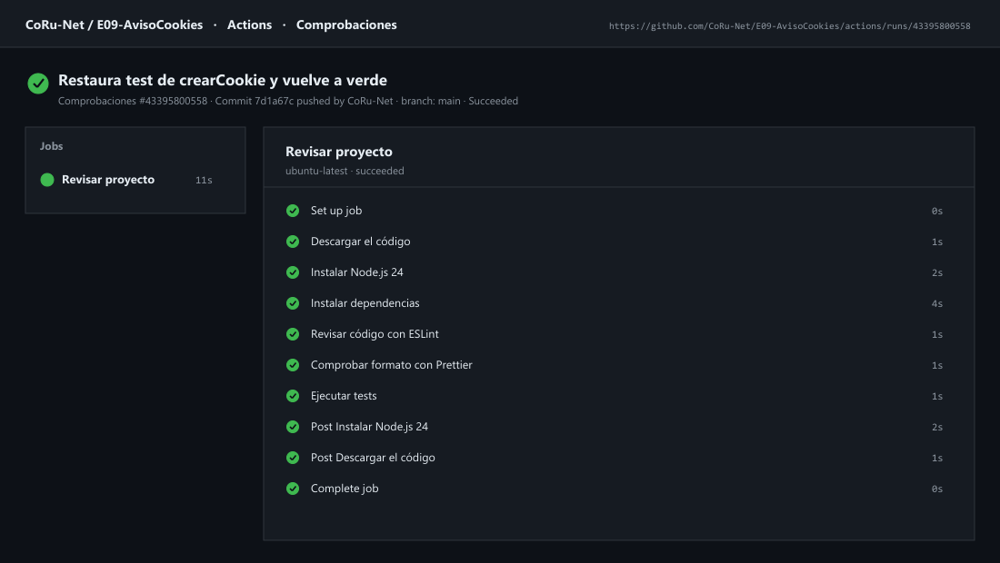
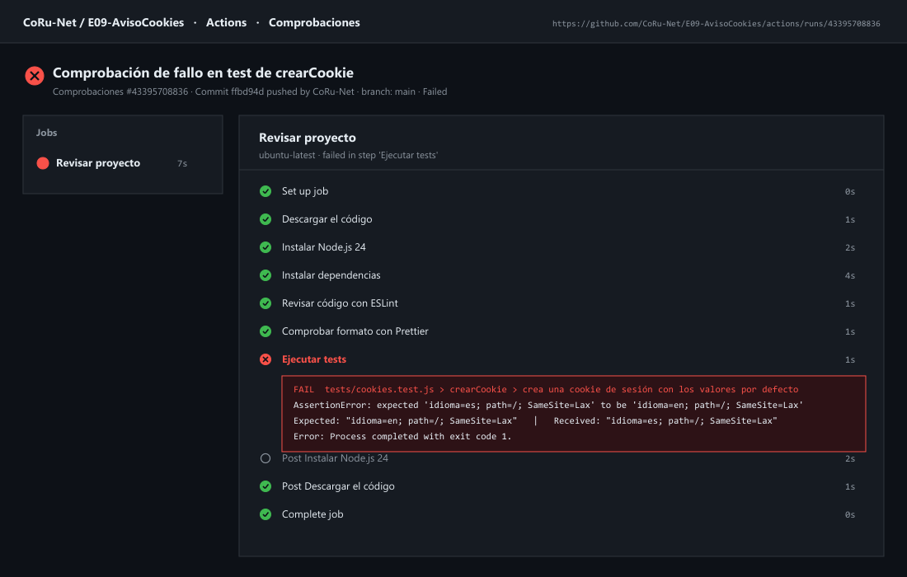

# Aviso de cookies y preferencias

## Cómo ejecutarlo

Abre la carpeta `E09-AvisoCookies` en VS Code, reabre su Dev Container y visita `http://localhost:3409`. En la terminal ejecuta `npm test`, `npm run lint` y `npm run format:check`.

## Qué se guarda y dónde

| Dato | Mecanismo | Clave o nombre | Duración | Por qué ese mecanismo |
|---|---|---|---|---|
| Consentimiento completo | `localStorage` | `consentimiento` | 12 meses (`CADUCIDAD_MESES`) | Permite leer desde JavaScript las categorías aceptadas (`version`, `analitica`, `personalizacion`, `fecha`) y comprobar su vigencia sin enviarlo en cada petición HTTP. |
| Resumen del consentimiento | Cookie HTTP (`document.cookie`) | `consentimiento` (`analitica` o `tecnicas`) | 1 año (`max-age=31536000`) | Demuestra cómo guardar una cookie con `path=/`, `SameSite=Lax` y `Secure` (en HTTPS) para que el servidor o el cliente conozcan el nivel aceptado. |
| Tema visual (`claro` / `oscuro`) | `localStorage` | `preferencias` (`{ "tema": "..." }`) | Indefinida (hasta que el usuario cambie o borre datos) | Es una preferencia técnica solicitada expresamente por el usuario que solo concierne a la interfaz en el cliente. |
| Aplazamiento del aviso | `sessionStorage` | `consentimiento-aplazado` (`'si'`) | Mientras dure la pestaña actual | Evita volver a abrir el diálogo cada vez que el usuario recarga la pestaña si eligió «Decidir más tarde» o `Esc`, pero vuelve a preguntar en una sesión nueva. |

## Privacidad

El tema claro/oscuro se considera una preferencia técnica solicitada directamente por el usuario al pulsar el botón, por lo que no requiere consentimiento previo. En cambio, las categorías opcionales (`analítica` y `personalización`) vienen desmarcadas por defecto y **nada no técnico se activa antes de que el usuario tome una decisión explícita**: el mensaje `📊 Analítica activada (simulada)` solo se ejecuta en consola cuando existe un consentimiento vigente con `analitica: true`. Además, la decisión guarda su fecha ISO y caduca a los 12 meses (o si cambia `VERSION`), obligando a renovar el consentimiento.

## Interacción

Al abrir `http://localhost:3409` por primera vez, `#resumen-cookies` muestra `Aún no has decidido sobre las cookies.` y se abre automáticamente el `<dialog id="aviso-cookies">` modal:
- **Aceptar todas**: guarda `analitica: true` y `personalizacion: true` en `localStorage`, escribe la cookie `consentimiento=analitica; max-age=31536000; path=/; SameSite=Lax`, actualiza `#resumen-cookies` a `Cookies aceptadas: técnicas, analítica y personalización (...)` y activa la analítica simulada en consola.
- **Rechazar**: guarda ambas en `false`, escribe la cookie `consentimiento=tecnicas` y muestra `Cookies aceptadas: técnicas (...)`.
- **Guardar selección**: respeta el estado de las casillas marcadas.
- **Decidir más tarde** o tecla `Esc`: anota `consentimiento-aplazado = 'si'` en `sessionStorage` sin guardar consentimiento ni activar analítica.
- El botón **Configurar cookies** (`#configurar-cookies`) permite reabrir el diálogo en cualquier momento con las casillas precargadas según la decisión anterior.

## Pruebas

`npm test`:

```text
 RUN  v5.1.0
 ✓ tests/cookies.test.js (3 tests)
 ✓ tests/preferencias.test.js (1 test)
 ✓ tests/consentimiento.test.js (4 tests)

 Test Files  3 passed (3)
      Tests  8 passed (8)
```

Los tests verifican `cookies.js`, `consentimiento.js` y `preferencias.js` en Node.js usando `AlmacenFalso` como doble de prueba en memoria, `vi.useFakeTimers()` y `vi.setSystemTime()` para comprobar el último milisegundo antes de caducar a los 12 meses y el instante exacto de caducidad (restaurando el reloj en `afterEach`), y `vi.fn()` para espiar y simular fallos de escritura en el almacenamiento.

## Depuración

Verificado en el navegador (`http://localhost:3409`) y en el panel **Aplicación** (*Application*) de las DevTools:
1. Tras pulsar **Aceptar todas**, en `Application → Local Storage → http://localhost:3409` aparece la clave `consentimiento` con `{"version":1,"analitica":true,"personalizacion":true,"fecha":"..."}` y en `Cookies` aparece `consentimiento` con valor `analitica` y `SameSite=Lax`.
2. Al pulsar **🌙 Oscuro**, se añade la clave `preferencias` con `{"tema":"oscuro"}` y al recargar se mantiene el modo oscuro.
3. Si en `Application → Local Storage` se edita manualmente la fecha de `consentimiento` a hace más de un año o se rompe el JSON (`{`), al recargar la página `leerConsentimiento()` / `consentimientoVigente()` lo detecta sin lanzar excepciones y vuelve a abrir automáticamente el diálogo de consentimiento.

## Herramientas

- `npm run lint`: finaliza sin errores.
- `npm run format:check`: `Checking formatting... All matched files use Prettier code style!`.

## Integración continua (opcional)

Se ha configurado el workflow `.github/workflows/ci.yml` en el repositorio [`CoRu-Net/E09-AvisoCookies`](https://github.com/CoRu-Net/E09-AvisoCookies) con instalación mediante `npm ci` y comprobación de ESLint, Prettier y Vitest:

- **Ejecución en verde:** [https://github.com/CoRu-Net/E09-AvisoCookies/actions/runs/43395800558](https://github.com/CoRu-Net/E09-AvisoCookies/actions/runs/43395800558)
- **Ejecución en rojo (comprobación de fallo en `crearCookie`):** [https://github.com/CoRu-Net/E09-AvisoCookies/actions/runs/43395708836](https://github.com/CoRu-Net/E09-AvisoCookies/actions/runs/43395708836)

### Captura de la ejecución en verde



### Captura de la ejecución en rojo


